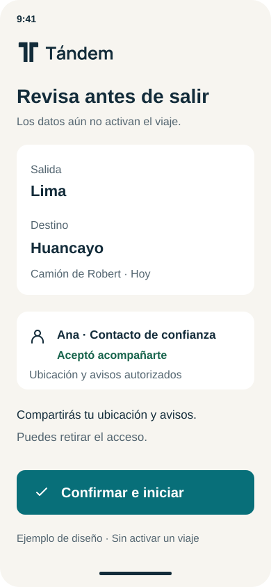
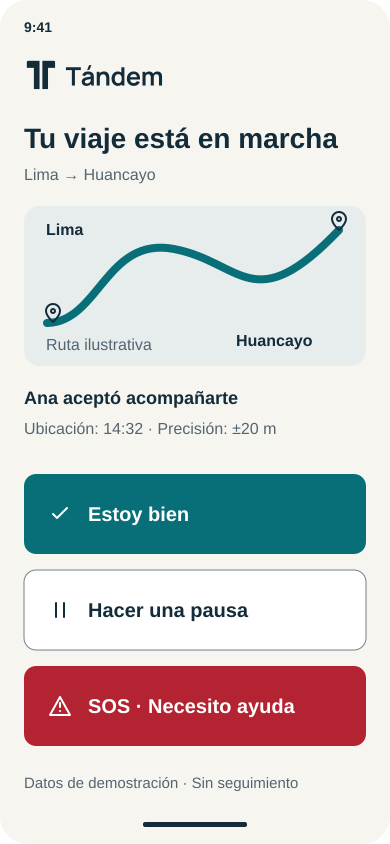
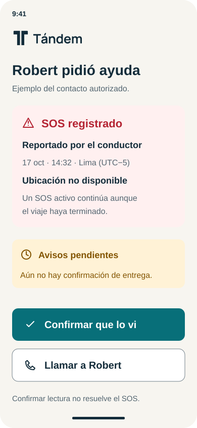

<p align="center">
  <picture>
    <source media="(prefers-color-scheme: dark)" srcset="docs/design/assets/tandem-logo-white.svg">
    
  </picture>
</p>

<h1 align="center">Tándem · Hack the Andes 2026</h1>

<p align="center"><strong>Tu gente, contigo en ruta.</strong></p>

<p align="center">Track Seguridad · Equipo GOAT</p>

<p align="center">
  <a href="#para-el-jurado-cómo-entrar"><code>Demo · en construcción</code></a>
  <a href="docs/submission/deck/index.html"><code>Pitch deck</code></a>
  <a href="https://github.com/Bimbi-Dev/andes-hackathon/actions/workflows/ci.yml?query=branch%3Amain"><code>CI · main ↗</code></a>
</p>

Tándem es una app para el transportista que maneja su propio camión. Las personas que él elige (su familia, sus colegas) ven dónde va y hace cuánto se tomó esa ubicación. Si pide ayuda con el botón SOS, o si deja de dar señales y no responde «Estoy bien», el servidor les avisa por SMS, WhatsApp y llamada. No hay central de monitoreo: la red de apoyo es la gente que el conductor ya tiene.

Hoy funciona y está probado el backend completo. La app del conductor en el teléfono se está construyendo y todavía no hay nada desplegado; el detalle está en [Qué funciona hoy y qué no](#qué-funciona-hoy-y-qué-no).

ANDES es el nombre del repositorio y del proyecto; Tándem es la app; GOAT es el equipo.

## Para el jurado: cómo entrar

> [!IMPORTANT]
> **La demo guiada está EN CONSTRUCCIÓN y todavía no hay URL.** El recorrido de abajo es el diseño aprobado, no algo que ya se pueda abrir. Lo define la [spec de la demo funcional](https://github.com/Bimbi-Dev/andes-hackathon/blob/docs/functional-phone-demo-spec/docs/superpowers/specs/2026-10-18-functional-phone-demo-design.md), en la rama `docs/functional-phone-demo-spec`, que aún no está en `main`.

**Demo:** [[PENDIENTE: URL de la demo]]

Se abrirá en una ventana privada, sin cuenta, sin pedir acceso y sin archivos locales. El botón **Empezar** crea una sesión de demostración aislada con el modo demo que ya existe en el backend ([`POST /v1/demo/session`](docs/contracts/runtime.md#demo-mode)). El único permiso que pedirá el navegador será la ubicación, y solo al tocar «Compartir ubicación».

Recorrido previsto:

1. **Empezar.**
2. **Registra tu camión** (placa o apodo).
3. **Agrega a tu contacto de emergencia** con su número. El contacto abre su link en otro teléfono y **verifica su propio número con un código SMS**.
4. **El contacto acepta.** La app guiada pide este contacto aceptado antes de dejarte crear el viaje, porque el backend une a los contactos al viaje solo en el momento de confirmarlo.
5. **Crea el viaje**: origen, destino, hora estimada de llegada y camión. Revisas y confirmas.
6. **Comparte la ubicación.** El contacto la ve con su hora y su precisión.
7. **SOS** (avisa al instante) o **Estoy bien** (responde a un check del servidor).
8. **Llegué**: termina el viaje y deja de compartir la ubicación.

Lo que ya se puede verificar sin la URL: el [CI de `main`](https://github.com/Bimbi-Dev/andes-hackathon/actions/workflows/ci.yml?query=branch%3Amain) y, en local con un PostgreSQL desechable, `npm run demo` (ver [comandos](#estructura-del-repositorio-y-comandos)). El repositorio es privado por ahora: [[PENDIENTE: el repositorio debe ser público]].

## Navegación rápida

| Empieza aquí | Qué encuentras |
|---|---|
| [Para el jurado: cómo entrar](#para-el-jurado-cómo-entrar) | La demo y su estado real |
| [El problema](#el-problema) · [Para quién](#para-quién) · [Cómo funciona](#cómo-funciona) | La propuesta |
| [Qué funciona hoy y qué no](#qué-funciona-hoy-y-qué-no) | Lo construido, lo pendiente y lo no validado |
| [Arquitectura e infraestructura](#arquitectura-e-infraestructura) · [ADR-002](docs/architecture/ADR-002-aws-durable-dispatch.md) · [Justificación](docs/architecture/justificacion-arquitectura.md) | Las decisiones técnicas y la falla que evita cada una |
| [Contrato de ejecución](docs/contracts/runtime.md) | Las rutas HTTP y el comportamiento exacto del backend |
| [Calidad y verificación](#calidad-y-verificación) | CI, conteo de pruebas y proceso de revisión |
| [Tracción](#tracción) · [Limitaciones](#limitaciones) | Lo que falta probar con personas reales |
| [Diseño](#diseño) · [Pitch deck](docs/submission/deck/index.html) · [Descripción de la entrega](docs/submission/descripcion.md) | Sistema de diseño y material de la entrega |

El deck es una página HTML: ábrelo en un navegador (GitHub muestra su código fuente). Su URL publicada está pendiente.

## El problema

En carretera hay dos riesgos que motivan el proyecto: el robo o intento de robo al camión de carga, y el cansancio o el sueño al manejar ([plan](docs/PLAN.md)).

Durante un asalto, puede que el conductor no logre pedir ayuda: le quitan el celular o lo amenazan. Las grandes flotas tienen telemetría y una central de monitoreo. El **hombre-camión**, el dueño que maneja su propio camión, no tiene una central que siga su viaje: tiene a sus personas cercanas y sus grupos de WhatsApp de choferes.

Nuestra hipótesis es que entre el momento en que algo sale mal y el momento en que alguien actúa pasa un tiempo evitable. Todavía no la hemos comprobado: es lo primero que deben confirmar o descartar las entrevistas ([#8](https://github.com/Bimbi-Dev/andes-hackathon/issues/8)).

Las cifras de contexto que usamos son las del [deck](docs/submission/deck/index.html), cada una con su fuente. Según el MTC (flota formal de carga al cierre de 2021, citado en P. Ruiz Rodríguez, *Predictiva21*, 2023), 96 de cada 100 vehículos de carga formales están en empresas con menos de 250 unidades, y 3 de cada 4 de esas empresas son hombre-camión. Para el cansancio no encontramos cifras publicadas sobre choferes de carga; el estudio peruano más cercano es una encuesta a 166 conductores de ómnibus interprovincial de Arequipa (*Rev Peru Med Exp Salud Publica*, 2014). No usamos otras cifras.

Un teléfono en silencio no prueba un robo ni que el conductor se durmió, y Tándem no lo trata como si lo probara.

## Para quién

- **El conductor:** transportistas de carga independientes en Latinoamérica, incluido Brasil, que tienen u operan uno o dos camiones. El cliente es el conductor, no una empresa: no hace falta una cuenta de flota ni una central de control.
- **Su gente:** las personas de confianza que él elige, en dos roles, **familia** y **colegas**. Cada contacto acepta por su cuenta, con su número verificado, y cualquiera de los dos lados puede revocar el permiso.
- **El encaje con el track:** el track Seguridad cubre la seguridad de empresas y operadores de transporte. Tándem apunta al operador más pequeño, el que es dueño y chofer a la vez.

La interfaz se diseña para español y portugués de Brasil. La demo usa Perú (corredor Panamericana Sur, número de emergencia 105). Los datos de un corredor no validan toda la región.

## Cómo funciona

**1. Viaje confirmado.** Con el camión detenido, el conductor escribe su viaje y completa los campos: origen, destino, hora estimada de llegada (que debe estar en el futuro), camión, país, idioma y zona horaria. Elige a sus contactos ya aceptados (hasta diez), revisa y confirma. Nada se activa sin esa confirmación. Dictar el viaje por voz no está implementado: el backend responde 422 `unsupported_audio`.

**2. Ubicación con frescura honesta.** El contacto con permiso de mapa ve la última ubicación con su hora de captura, su antigüedad y su precisión. Hasta 120 segundos es «reciente»; después, «antigua»; sin muestras, «no disponible». La app nunca inventa una posición. El permiso se revisa en cada lectura, así que al revocar o al llegar se niegan de inmediato las lecturas nuevas.

**3. Pausa.** Al descansar, el conductor pone Pausa: se suspenden los checks y los avisos ordinarios, pero el mapa no se apaga a escondidas y el SOS sigue disponible.

**4. Check «Estoy bien».** El servidor, no el celular, abre un check cuando se deja de compartir la ubicación, cuando no hay señales de vida durante un tiempo o cuando la llegada se atrasa. Pregunta una sola vez, con un botón grande: «Estoy bien». En la demo, los tiempos son 2 minutos sin señal, 1 minuto para responder y 2 minutos de gracia para la llegada. Son valores para el escenario, no umbrales de seguridad validados ([#11](https://github.com/Bimbi-Dev/andes-hackathon/issues/11)), y la plantilla de producción los deja sin definir.

**5. Escalamiento.** Si no responde a tiempo, el servidor abre un incidente y avisa igual que con un SOS. El mensaje dice qué no se confirmó y da la última ubicación con su antigüedad, y cierra con «No sabemos qué pasó. Llámalo; si no responde, llama al 105». Un «Estoy bien» tardío queda registrado, pero no cancela la alerta: solo el conductor la cierra de forma explícita, porque un OK dado bajo amenaza no debe silenciar al resto.

**6. Botón SOS.** Un toque avisa al instante. En una sola transacción se guardan el incidente y un trabajo por cada destinatario y canal, y todos los canales salen en paralelo:

| Quién | Canales |
|---|---|
| Familia | SMS, WhatsApp y llamada |
| Colegas | SMS y WhatsApp |
| Grupo de WhatsApp de choferes | Diseñado como un trabajo aparte, pero hoy **siempre queda «no disponible»** (`group_support_unverified`): no hemos verificado que el proveedor entregue a grupos. Los mensajes individuales nunca lo reemplazan. |

Tocar SOS varias veces no duplica avisos: todos los toques se unen al mismo episodio. «Llegué» no cierra un SOS abierto. La entrega real por Zavu no está confirmada todavía; sin ella, cada trabajo de envío queda en estado `unavailable` y la pantalla del contacto lo muestra como «No disponible».

**7. Los contactos registran lo que hicieron.** Un contacto puede marcar que recibió la alerta y registrar qué acción tomó. Son hechos separados: entregado no es leído, y leído no es ayuda.

**8. Etiquetas de incidentes.** El conductor etiqueta cada incidente: robo, intento de robo, falsa alarma, sin señal u otro. Al mapa solo llegan los robos y los intentos, junto con los reportes directos de robo o intento (máximo 5 por persona al día).

**9. Mapa de zonas.** La página pública `/mapa` muestra celdas de unos 5 km, de día y de noche, en los últimos 90 días. Cada número cuenta **personas distintas**, no reportes: quien reporta diez veces cuenta una vez. Una zona solo aparece con **al menos 3 personas distintas con teléfono verificado**, así que un solo usuario no puede inventar un punto peligroso. Si hay datos de demostración, la página lo dice («incluye datos de demostración»). El consejo por zona es una regla de conteo, no un modelo de riesgo.

## Qué funciona hoy y qué no

**En `main`, con pruebas automáticas** (verificado en `23e9f33`):

| Pieza | Dónde |
|---|---|
| Backend completo: API de camiones, contactos, viajes, ubicación, comandos (Pausa, Estoy bien, Llegué), SOS, incidentes, etiquetas, reportes y estado | [`src/`](src/), [contrato](docs/contracts/runtime.md) |
| Envío durable: outbox, colas SQS, intentos independientes por canal, conciliación, adaptador Zavu y callbacks firmados | [`src/notifications/`](src/notifications/) |
| Checks de seguridad y escalamiento en el servidor | [`src/checks/`](src/checks/) |
| Modo demo sin cuenta (personas sintéticas aisladas) | [`src/demo.ts`](src/demo.ts) |
| Datos de incidentes: mapa público y consejo por zona | [`src/insights/`](src/insights/), [`public/mapa.html`](public/mapa.html) |
| Cliente tipado de la API y sesión en memoria | [`web/src/lib/api/`](web/src/lib/api/) |
| Controlador del recorrido del conductor (sin pantalla) | [`web/src/features/driver/`](web/src/features/driver/) |
| Pantallas del contacto y de privacidad | [`web/src/features/contacts/`](web/src/features/contacts/), [`web/src/features/privacy/`](web/src/features/privacy/) |
| Adaptador de GPS del teléfono y cola durable de subida. **No están conectados a ninguna pantalla.** | [`src/phone-observations/`](src/phone-observations/), [`web/src/lib/observations/`](web/src/lib/observations/) |
| Arnés de integración y prueba de navegador contra el backend real, en CI | [`scripts/app-integration/`](scripts/app-integration/), [guía](docs/testing/local-app.md) |

**Todavía no:**

- **La app web de producción es un cascarón.** [`web/src/main.tsx`](web/src/main.tsx) monta el shell sin rutas ni sesión: las pantallas de cada función aparecen como «no disponible».
- **Las pantallas del conductor y el recorrido guiado** se están construyendo ([spec](https://github.com/Bimbi-Dev/andes-hackathon/blob/docs/functional-phone-demo-spec/docs/superpowers/specs/2026-10-18-functional-phone-demo-design.md) en la rama `docs/functional-phone-demo-spec`).
- **Nada está desplegado.** El script de la demo existe, pero no se ha ejecutado y no hay URL.
- **La entrega real por Zavu no está confirmada.** Los envíos están apagados por defecto (`ZAVU_LIVE_SEND=false`).
- **El viaje por voz** no está implementado.

**Sin validar** (gates de evidencia abiertos):

| Gate | Estado |
|---|---|
| [#8](https://github.com/Bimbi-Dev/andes-hackathon/issues/8) Entrevistas con transportistas y sus contactos | El kit está listo; no se ha hecho ninguna entrevista |
| [#9](https://github.com/Bimbi-Dev/andes-hackathon/issues/9) Límites del teléfono físico | La [matriz](docs/evidence/phone-capability/result-matrix.csv) está toda en `not-run`; Android sin probar |
| [#10](https://github.com/Bimbi-Dev/andes-hackathon/issues/10) Recibos reales del proveedor | Sin envíos reales |
| [#11](https://github.com/Bimbi-Dev/andes-hackathon/issues/11) Umbrales de seguridad | Los tiempos de los checks son valores de demo |

## Arquitectura e infraestructura

![Arquitectura de ANDES en AWS. El conductor y el contacto entran por un ALB HTTPS a la API en ECS/Fargate. La API guarda incidente, trabajos y outbox en un solo commit en RDS PostgreSQL Multi-AZ. El worker de control lee la intención y publica en dos colas SQS, emergencia y ordinaria, cada una con su DLQ, que solo llevan ID y versión. Los servicios de entrega autorizan en SQL, liberan la conexión y llaman a Zavu para SMS, WhatsApp y llamada. Zavu devuelve callbacks firmados a la API. Secrets Manager y CloudWatch dan soporte. Pendiente de validar: despliegue en AWS, Zavu real, GPS en el dispositivo y carga.](docs/architecture/diagrams/andes-infrastructure-professional.png)

[SVG editable](docs/architecture/diagrams/andes-infrastructure-professional.svg) · [Captura en Figma](docs/architecture/diagrams/andes-architecture-figma.jpg) · [Vista detallada original](docs/architecture/diagrams/andes-infrastructure.png) · [Notas del diagrama](docs/architecture/diagrams/README.md). El diagrama describe lo implementado y la plantilla de AWS, **no un despliegue ejecutado**.

La decisión está en [ADR-002](docs/architecture/ADR-002-aws-durable-dispatch.md): una API modular en **TypeScript/Fastify** y workers en **ECS/Fargate** (una sola imagen y cuatro procesos: API, control, entrega de emergencia y entrega ordinaria), **RDS PostgreSQL** como única autoridad de estado, un **outbox transaccional** que publica en **SQS** con colas separadas de emergencia y ordinaria, y **Zavu** como proveedor de SMS, WhatsApp y llamada. Cada decisión clave responde a una falla concreta:

| Decisión | Falla que evita |
|---|---|
| PostgreSQL es la autoridad; el teléfono y la memoria de un proceso no lo son | Que una alerta se pierda porque el teléfono se apagó o un proceso se reinició |
| Outbox: el incidente, sus trabajos de envío y la intención de publicar se guardan en un solo commit | «Guardé el SOS pero no lo encolé»: si un proceso cae después del commit, la alerta sale al reiniciar |
| Colas SQS separadas de emergencia y ordinaria, cada una con su DLQ, que solo llevan ID, versión y clase | Que el trabajo ordinario retrase un SOS, o que teléfonos y ubicaciones viajen por la cola |
| Un solo intento autorizado por trabajo y versión; un resultado perdido queda «desconocido» y se concilia consultando al proveedor | Una alarma doble a ciegas |
| Cupos por canal en cada consumidor (2 SMS, 2 WhatsApp y 2 llamadas por réplica) | Que un WhatsApp lento frene el SMS y la llamada |
| Transacciones cortas, solo SQL: ninguna conexión ni lock queda abierto durante la llamada a Zavu; pools separados para comandos, telemetría y callbacks | Agotar la base esperando al proveedor, o que un pico de ubicaciones deje sin conexión al SOS |
| Cerrar el viaje o revocar un permiso serializa con la autorización de envíos, en una transacción corta por viaje | Que después de revocar se autorice un aviso nuevo con la ubicación |
| Los checks corren en el servidor, cada viaje en su propia transacción | Depender de un temporizador del navegador, o perder o duplicar un escalamiento en un reinicio |

Ningún componente promete entrega «exactamente una vez» de punta a punta; el diseño la acota con autorización única por intento y conciliación. La [justificación](docs/architecture/justificacion-arquitectura.md) explica por qué escala, por qué no Lambda, Step Functions, DynamoDB, Kubernetes, Kafka o Redis, y qué no promete.

**Dos formas de desplegar:**

- **Demo reducida:** [`infra/demo/deploy.sh`](infra/demo/deploy.sh) usa ECS Express Mode con una sola tarea Fargate (API y worker de control), RDS PostgreSQL 18.3 `db.t4g.micro` en una sola zona y las dos colas SQS. Va paso a paso (`prepare`, `image`, `database`, `bootstrap`, `lock`, `service`, `url`, `teardown`) y se niega a correr si la cuenta del perfil no es la indicada en `ANDES_AWS_ACCOUNT`. Los comentarios del script estiman unos 2 USD al día. No demuestra alta disponibilidad. **No se ha ejecutado.**
- **Objetivo de alta disponibilidad:** [`infra/template.json`](infra/template.json) es una plantilla CloudFormation con los cuatro servicios Fargate en dos zonas, RDS Multi-AZ privado y cifrado, ALB HTTPS, SQS con DLQ, Secrets Manager y CloudWatch. Los servicios se crean en cero hasta que el bootstrap termina bien. Pasa `cfn-lint` en CI, pero **no se ha aplicado**. El [runbook](infra/README.md) describe los requisitos y la secuencia.

## Diseño

El sistema de diseño de Tándem está en [`docs/design/`](docs/design/README.md), con su [especificación](docs/design/specification.md) y el contrato raíz [`DESIGN.md`](DESIGN.md).

- **Identidad:** dos caminos que avanzan juntos y forman una T: el conductor y su contacto. Los logos en SVG están en [`docs/design/assets/`](docs/design/assets/).
- **Tipografía:** Manrope, incluida en el repositorio con su licencia SIL OFL.
- **Tokens:** [`tokens.json`](docs/design/tokens.json) es la fuente canónica y [`tokens.css`](docs/design/tokens.css) se genera a partir de ella. Tinta `#132C3A`, petróleo de acción `#086F79` y marfil `#F7F5F0`. El rojo de emergencia `#B42332` se reserva para el SOS.
- **Controles:** objetivos táctiles de al menos 48 px, acciones principales de 64 px y acciones en ruta de 80 px. El orden Estoy bien, Pausa, SOS no cambia.
- **Pantallas de referencia:** seis composiciones de 390 × 844 en [`docs/design/screens/`](docs/design/screens/). Se revisaron catorce pares de contraste ([verificación](docs/design/evidence/verification.md)).

<p align="center">
  
  
  
</p>

Son referencias de diseño, no capturas de la app. Llevar este sistema a la app web es parte del trabajo en curso.

## Calidad y verificación

Cada push y cada PR corren el workflow [`Backend checks`](.github/workflows/ci.yml), con tres jobs independientes. Los conteos son de la última verificación: la corrida de CI en `main` sobre `23e9f33`, toda en verde.

| Job | Qué corre | Resultado |
|---|---|---|
| `backend` | Typecheck; `npm test` contra PostgreSQL 18 real; cliente compartido contra el backend; `npm run demo`; herramientas offline; `cfn-lint` de la plantilla; `docker compose config`; imagen Docker `linux/amd64` | 176/176 pruebas del backend; 31/31 de herramientas y 50/50 escenarios sintéticos; demo sin envíos reales |
| `web` | Typecheck; `npm test`; tipos de la API en modos NodeNext y Bundler; integraciones del límite de la API | 349 pruebas (344 pasan, 5 omitidas en ese paso, 0 fallan); 179/179 de integración |
| `app-integration` | Arnés del backend con un PostgreSQL propio; prueba de navegador contra el backend real; oráculo de aceptación | Arnés 206/206; navegador 8/8; oráculo 34/34 |

Hay además workflows con filtro de rutas para el kit de entrevistas, la cola de observaciones y el adaptador del teléfono. Ninguna prueba envía mensajes reales: todos los teléfonos e identidades son sintéticos.

**Revisión.** Después de los primeros commits del plan, el 17 de octubre de 2026, todo el trabajo entra por PR (ver la [lista de PRs fusionados](https://github.com/Bimbi-Dev/andes-hackathon/pulls?q=is%3Apr+is%3Amerged)); algunos pasan primero por ramas de integración que luego llegaron a `main`. Las reglas están en [`CONTRIBUTING.md`](CONTRIBUTING.md): Robert fusiona todos los PRs, incluidos los suyos; cada hallazgo accionable se resuelve en su hilo con el commit del arreglo y su prueba de regresión; y la fusión se hace con `--match-head-commit` sobre el SHA revisado, para que un cambio de último minuto la rechace. Antes de fusionar se exigen los arreglos pedidos en la revisión, cada uno con su prueba de regresión, y los revisores usan pruebas de mutación para comprobar que esa prueba falla si se revierte el arreglo. El [oráculo de aceptación](evidence/app-acceptance/README.md), por ejemplo, registra los contraejemplos que fallaban antes de su corrección. Los límites aceptados en vez de arreglados quedan escritos (ver [Limitaciones](#limitaciones)).

## Tracción

> [!WARNING]
> **[[PENDIENTE: entrevistas y uso real]]** Todavía no hay entrevistas, usuarios ni uso real. No presentamos tracción que no existe.

Lo que sí está listo:

- **Kit de evidencia** ([PR #46](https://github.com/Bimbi-Dev/andes-hackathon/pull/46)): un verificador sin dependencias ([`evidence/incident_kit.py`](evidence/incident_kit.py)) que revisa las planillas y exporta solo los casos con doble consentimiento, redacción revisada y trazabilidad independiente.
- **Materiales de entrevista** ([PR #79](https://github.com/Bimbi-Dev/andes-hackathon/pull/79)): [guías](evidence/guides/) en español y portugués de Brasil para el conductor y su contacto, guías para que cada persona revise su propio relato, el [brief de la cohorte](evidence/cohort-brief.md) y [planillas en blanco](evidence/templates/).
- **El protocolo** ([#8](https://github.com/Bimbi-Dev/andes-hackathon/issues/8)): cinco pares de conductor y contacto; cada par reconstruye un viaje preocupante y uno normal. Es exploratorio: no mide prevalencia ni eficacia.

| Evidencia | Estado |
|---|---|
| Entrevistas realizadas | [[PENDIENTE: número]] |
| Aprendizaje principal | [[PENDIENTE]] |
| Uso de la demo por personas externas | [[PENDIENTE]] |

## Limitaciones

**Del producto:**

- No evitamos robos ni detectamos armas, sueño o fatiga.
- Sin respuesta es «estado sin confirmar», nunca «robo confirmado».
- Si el ladrón presiona «Estoy bien», hoy no lo podemos distinguir.
- Los tiempos de los checks son valores de demo, no umbrales validados.
- El aviso a grupos de WhatsApp no está verificado (`group_support_unverified`).
- Los mensajes de alerta están solo en español.
- El viaje por voz no está implementado.
- No sabemos aún cómo se comporta la ubicación con la pantalla bloqueada o la app en segundo plano: eso se mide en [#9](https://github.com/Bimbi-Dev/andes-hackathon/issues/9).

**Del despliegue de la demo:**

- Es una «demo reducida»: una tarea y una zona, sin alta disponibilidad, sin autoscaling y sin prueba de carga.
- En `23e9f33`, [`deploy.sh`](infra/demo/deploy.sh) arranca solo la API y el worker de control (no los consumidores de entrega) y fija `ZAVU_LIVE_SEND=false`. La imagen Docker sirve la API y `/mapa`, pero todavía no la app web.
- El modo demo corre en una sola instancia: la clave de firma vive en memoria, así que los tokens terminan al reiniciar. Hay un máximo de 30 mundos por minuto, los datos de demo quedan en la base hasta borrarla y un mundo abandonado no avisa a nadie.
- El modo demo nunca se debe activar con usuarios reales ([contrato](docs/contracts/runtime.md#demo-mode)).

**Límites del backend aceptados para la demo** ([contrato](docs/contracts/runtime.md#known-backend-limits-accepted-for-the-demo)). Una revisión encontró 15 problemas. Se arreglaron los 5 críticos; de los otros 10, aceptados como límites, uno ya se arregló y estos nueve siguen abiertos:

1. La conciliación puede volver a encolar sin fin ciertos intentos aceptados o desconocidos.
2. Si SQL falla después de llamar al proveedor, un envío aceptado puede quedar como `authorized` o `unknown`.
3. Las rutas de lectura toman el lock de la fila del viaje (salvo `/status`).
4. La recuperación corre nueve consultas, casi sin índices, cada segundo en cada réplica de control.
5. Diferir mensajes cuenta para el límite de recepciones de SQS y puede mandar trabajo válido a la DLQ; SQL lo recupera.
6. El ciclo de recepción no atrapa algunos errores transitorios de la base o de SQS.
7. Las filas de idempotencia nunca se borran.
8. El relay publica una fila cada 100 ms por tarea, sin dar prioridad a las emergencias.
9. El hash del destino es SHA-256 sin sal y se guarda indefinidamente.

**Del mapa de zonas** (aceptados en [PR #76](https://github.com/Bimbi-Dev/andes-hackathon/pull/76), ver [contrato](docs/contracts/runtime.md#incident-data-and-insights)):

- Tres cuentas verificadas que se coordinan pueden publicar una celda que contiene el reporte de otra persona. Antes de usar datos reales hay que subir el mínimo, ponderar por antigüedad de la cuenta o agregar ruido a los conteos.
- El mapa se recalcula cada hora, así que un cambio en una celda publicada se puede atar a esa hora.
- Las coordenadas de incidentes y reportes todavía no tienen una política de borrado.

**Gates de evidencia abiertos:** entrevistas ([#8](https://github.com/Bimbi-Dev/andes-hackathon/issues/8)), teléfonos físicos ([#9](https://github.com/Bimbi-Dev/andes-hackathon/issues/9), Android sin probar), recibos reales del proveedor ([#10](https://github.com/Bimbi-Dev/andes-hackathon/issues/10)) y umbrales de seguridad ([#11](https://github.com/Bimbi-Dev/andes-hackathon/issues/11)).

## Estructura del repositorio y comandos

| Carpeta | Qué contiene |
|---|---|
| [`src/`](src/) | Backend TypeScript: API Fastify, envío durable, checks, demo, insights y el adaptador del teléfono |
| [`db/migrations/`](db/migrations/) | Migraciones SQL numeradas, con hash verificado |
| [`web/`](web/README.md) | App web React + Vite: shell, cliente tipado, pantallas del contacto, controlador del conductor y cola de observaciones |
| [`public/`](public/) | La página pública del mapa (`/mapa`) |
| [`scripts/`](scripts/) | Migración, bootstrap, semilla de demo, demo sintética y arnés de integración |
| [`tests/`](tests/) | Pruebas del backend contra PostgreSQL real |
| [`infra/`](infra/README.md) | Plantilla CloudFormation, script de la demo reducida y runbook |
| [`evidence/`](evidence/README.md) | Kit de entrevistas, oráculo de aceptación y herramientas offline |
| [`docs/`](docs/) | Plan, ADRs, contratos, diseño, pruebas y entrega |

Se necesita Node 24–26. Las pruebas del backend necesitan un PostgreSQL 15+ desechable; nunca uses datos reales. Las herramientas offline necesitan Python 3.10+.

| Comando | Para qué |
|---|---|
| `npm ci` | Instala las dependencias del backend |
| `npm run typecheck` | Revisa los tipos del backend |
| `TEST_DATABASE_URL=… npm test` | Compila y corre las pruebas del backend (cada prueba crea y borra su propio esquema) |
| `npm run demo` | Recorrido sintético: confirmación, ubicación reciente y antigua, SOS duplicado, reinicio sin reenvío y revocación |
| `npm run test:tooling` · `npm run test:all` | Herramientas offline · backend y herramientas juntos |
| `npm run build` · `npm start` | Compila · arranca la API |
| `npm run migrate` · `npm run bootstrap` | Migraciones locales · bootstrap de administrador (login de la app, migraciones y permisos) |
| `SEED_DEMO=1 npm run seed:demo` | Datos sintéticos para el mapa (después de `npm run build`) |
| `npm run worker:control` · `npm run worker:emergency` · `npm run worker:ordinary` | Los workers; los de entrega se niegan a arrancar con `ZAVU_LIVE_SEND=false` |
| `npm run infra:check` | Revisiones de la plantilla de infraestructura |
| `npm ci --prefix web` · `npm --prefix web test` | Instala y prueba la app web (la prueba compila primero) |
| `npm --prefix web run dev` · `npm --prefix web run build` · `npm --prefix web run preview` | Servidor de desarrollo · build de producción · vista previa del build |
| `node scripts/app-integration/run.mjs` | Arnés de integración con su propio PostgreSQL |
| `node scripts/app-integration/check-browser-seam.mjs` | Prueba de navegador contra el backend (requiere `npm ci` en `web/`) |
| `node --test evidence/app-acceptance/oracle.test.mjs` | Oráculo de aceptación |

Con Docker Compose (solo datos sintéticos locales; antes define `LOCAL_ADMIN_PASSWORD` y `LOCAL_APP_PASSWORD`, de uso local):

```sh
docker compose up -d db
docker compose run --rm bootstrap
# Antes, define OIDC_ISSUER, OIDC_AUDIENCE y OIDC_JWKS_URL de un emisor real
docker compose --profile api up -d api
```

El trabajo se organiza en siete secciones con 44 issues; el [plan completo](docs/PLAN.md) y la [división del trabajo](docs/OWNERSHIP.md) están en `docs/`.

## Equipo y licencia

Somos el equipo **GOAT**. El nombre de la app viene de su idea central: el conductor y su gente avanzan juntos, en tándem, y por eso el símbolo son dos caminos que forman una T.

| | Responsabilidades principales |
|---|---|
| **Robert** ([@Robertzu43](https://github.com/Robertzu43)) | Arquitectura, estado del servidor y contratos de eventos, envío durable, integraciones de canales, infraestructura y evaluación reproducible |
| **Sebastian** ([@sebasbimbi](https://github.com/sebasbimbi)) | Evidencia con conductores, acceso al proveedor, la app web (base, cliente tipado, recorridos del conductor y del contacto), captura del teléfono, consentimiento y decisiones de piloto; el pitch deck |

**Licencia:** sin licencia definida todavía. El repositorio no tiene archivo `LICENSE`.
