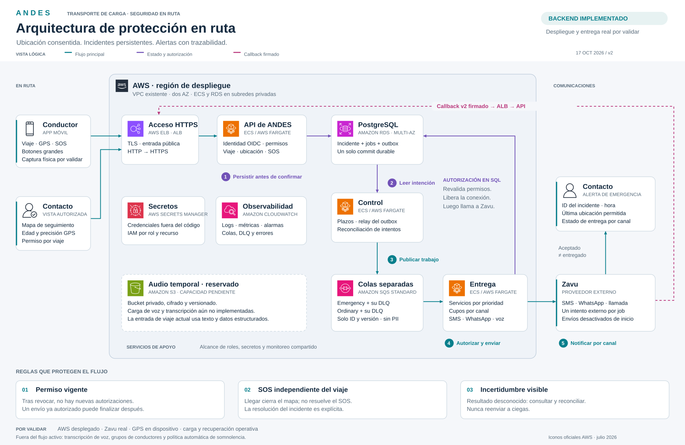

# Infraestructura y operación

Esta vista lógica muestra una sola base de estado y cinco pasos de operación. El contorno representa AWS, no una subred: ALB es público; ECS y RDS usan subredes privadas; SQS, S3 y los servicios de apoyo son regionales. El contacto que observa el mapa y quien recibe alertas pueden ser la misma persona, con permisos independientes. La conexión SQL de los consumidores se libera antes de llamar a Zavu.

Los iconos conservan los vectores y colores del [paquete oficial AWS de julio de 2026](https://aws.amazon.com/architecture/icons/). Zavu aparece como texto; no se presenta un logotipo inventado. El SVG es autocontenido (sin imágenes remotas ni scripts), con grupos por componente, y se puede importar en Figma: [ANDES — Arquitectura de protección en ruta](https://www.figma.com/design/RGVfq91b25JmWFuespSFbp/ANDES?node-id=1-2).

La fuente de verdad es [la plantilla CloudFormation](../../../infra/template.json), junto con [el contrato ejecutable](../../contracts/runtime.md) y [ADR-002](../ADR-002-aws-durable-dispatch.md). La imagen no acredita entrega a grupos de WhatsApp, transcripción, continuidad del GPS en el teléfono ni capacidad medida bajo carga.
