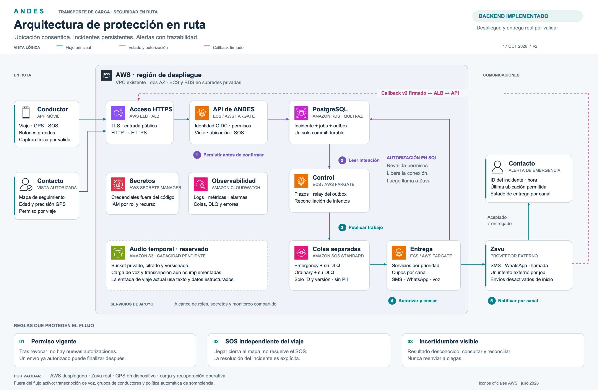
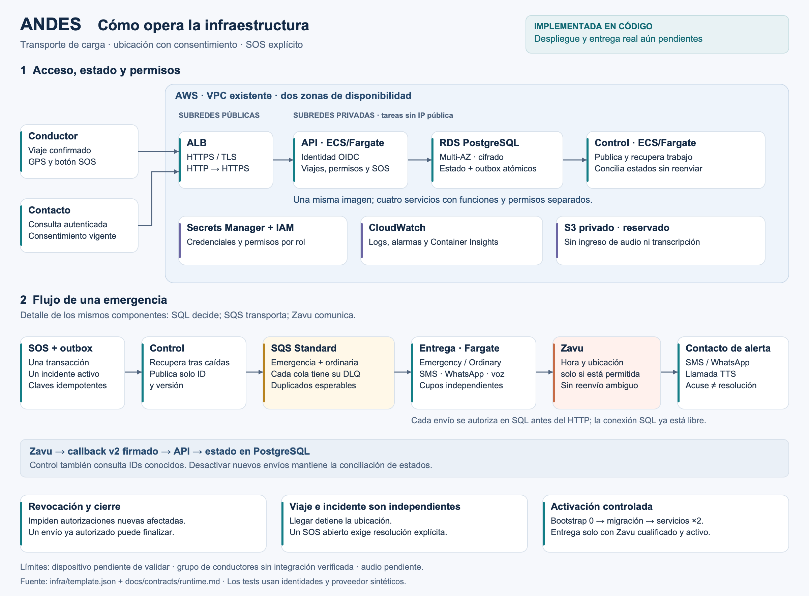

# Infraestructura y operación

## Vista profesional con iconos oficiales

[Imagen PNG](andes-infrastructure-professional.png) · [Fuente SVG vectorial para Figma](andes-infrastructure-professional.svg)



Esta vista lógica muestra una sola base de estado y cinco pasos de operación. El contorno representa AWS, no una subred: ALB es público; ECS y RDS usan subredes privadas; SQS, S3 y los servicios de apoyo son regionales. El contacto que observa el mapa y quien recibe alertas pueden ser la misma persona, con permisos independientes. La conexión SQL de los consumidores se libera antes de llamar a Zavu.

Los iconos conservan los vectores y colores del [paquete oficial AWS de julio de 2026](https://aws.amazon.com/architecture/icons/), descargado desde [AWS](https://d1.awsstatic.com/onedam/marketing-channels/website/public/shared/architecture-icon-release/Icon-package_07312026.5846e92413caa21490223536cc97f1269e44fa92.zip). Incluye Fargate, ELB, RDS, SQS, S3, Secrets Manager, CloudWatch y los recursos de usuario/cliente. Zavu aparece como texto; no se presenta un logotipo inventado.

El SVG es autocontenido, sin imágenes remotas ni scripts, organizado en grupos identificados por componente. Se puede importar en un archivo Figma Design. Importado en [Figma: ANDES — Arquitectura de protección en ruta](https://www.figma.com/design/RGVfq91b25JmWFuespSFbp/ANDES?node-id=1-2). Se verificaron el renderizado, las capas de texto editables y el frame de 2760 × 1800. [Captura del canvas en Figma](andes-architecture-figma.jpg). La fuente SVG conserva una copia editable independiente.

```sh
sips -s format png docs/architecture/diagrams/andes-infrastructure-professional.svg \
  --out docs/architecture/diagrams/andes-infrastructure-professional.png
```

## Vista detallada original

[Imagen PNG](andes-infrastructure.png) · [Fuente SVG editable](andes-infrastructure.svg)



El primer panel muestra acceso, permisos y persistencia. El segundo amplía el flujo del mismo outbox y proceso de control hacia las dos colas y los procesos de entrega. No representa dos bases de datos ni dos procesos de control adicionales. El cliente móvil aparece como consumidor del contrato; su captura física sigue pendiente de validación.

La fuente de verdad es [la plantilla CloudFormation](../../../infra/template.json), junto con [el contrato ejecutable](../../contracts/runtime.md) y [ADR-002](../ADR-002-aws-durable-dispatch.md). La imagen describe los artefactos implementados, **no un despliegue ejecutado**. La VPC, sus rutas, el acceso externo a OIDC/Zavu y los recursos específicos de cuenta requieren la verificación del runbook.

El SVG contiene texto y figuras editables, sin recursos externos. Para regenerar el PNG después de editarlo, en macOS:

```sh
sips -s format png docs/architecture/diagrams/andes-infrastructure.svg \
  --out docs/architecture/diagrams/andes-infrastructure.png
```

Los servicios se crean detenidos para bootstrap. Después de migrar correctamente, API/control tienen dos tareas cada uno; emergency/ordinary solo tienen dos tareas cuando se habilita el envío real cualificado. La imagen no acredita entrega a grupos de WhatsApp, transcripción, continuidad del GPS en el teléfono ni capacidad medida bajo carga.
