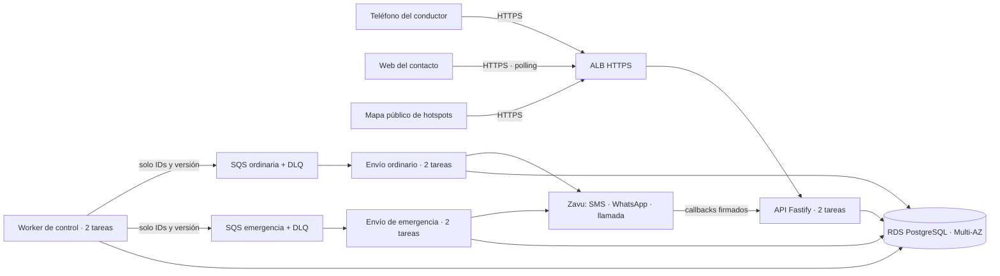

# Por qué esta arquitectura, por qué escala y por qué no otras

Estado: justificación de la decisión vigente, [ADR-002](ADR-002-aws-durable-dispatch.md). No reabre la elección; explica por qué se mantiene. Ese ADR explica la decisión; este documento la defiende ante el equipo y el jurado. Nada está desplegado y nada se probó bajo carga: las cifras de escala son un modelo, no una medición.

## En una frase

Una sola base de código TypeScript corre en AWS ECS/Fargate. PostgreSQL (RDS Multi-AZ) es la única fuente de verdad. Un outbox transaccional publica trabajos en dos colas SQS, emergencia y ordinaria, y workers aislados envían por Zavu SMS, WhatsApp y llamada. Elegimos lo más simple que garantiza que **un SOS confirmado no se pierde, no se duplica y no espera a un canal lento**.

## Qué tiene que garantizar el sistema

La arquitectura no se eligió por moda ni por la marca del proveedor. La eligen seis garantías del producto:

1. **Un SOS confirmado sobrevive a cualquier caída.** Incidente, trabajos e intención de envío se guardan en la misma transacción. Si un worker muere después del commit, otro lo retoma. El teléfono y la memoria de un proceso no son la autoridad.
2. **Nada se envía dos veces por error.** Cada intento por destinatario y canal se autoriza una sola vez. Un resultado perdido queda como «desconocido» y se concilia leyendo el estado del proveedor; no se reenvía a ciegas.
3. **Un canal lento no bloquea a los demás.** Si WhatsApp tarda, el SMS y la llamada siguen, y también otros viajes y la revocación del mapa.
4. **Revocar o llegar corta el acceso de inmediato.** Cada lectura del mapa vuelve a comprobar el permiso en la base principal. No hay caché compartida de ubicaciones.
5. **La telemetría no ahoga a las emergencias.** Las muestras de ubicación son muchas y baratas; los SOS son pocos y críticos. Usan conexiones y colas separadas.
6. **La ubicación es privada y el mapa público es agregado.** Una celda real solo aparece con al menos 3 personas distintas. Una cuenta sola no crea un punto peligroso y los datos de demostración nunca destapan un reporte real.

## La arquitectura

| Pieza | Qué hace | Por qué así |
|---|---|---|
| API (Fastify, sin estado) | Identidad, viajes, consentimiento, ubicación, SOS, callbacks, insights | Detrás del ALB se agregan tareas idénticas; no guarda estado propio |
| PostgreSQL (RDS Multi-AZ, privado, cifrado, backups de 7 días) | Viajes, permisos, incidentes, trabajos, intentos, outbox, datos de incidentes | Necesitamos transacciones entre varias tablas y SQL para permisos y agregados |
| Outbox transaccional | El cambio de estado y la intención de envío se guardan juntos | Evita la doble escritura inconsistente «guardé en la base pero no en la cola» |
| Worker de control | Publica el outbox, recupera trabajo vencido, concilia intentos ambiguos (y, al integrar la parte 1, revisa los chequeos de seguridad) | Bucles cortos con *leases*: se pueden correr varias réplicas sin duplicar |
| SQS emergencia / ordinaria + DLQ | Transporte con reentrega; 5 recepciones antes de la DLQ | Absorbe ráfagas; lo ordinario nunca retrasa una emergencia |
| Consumidores por clase | Autorizan un intento, llaman a Zavu una vez y registran el resultado | Cupos por canal (2 SMS, 2 WhatsApp, 2 voz por tarea): un canal lento no ocupa los otros |
| Zavu (detrás de un adaptador) | SMS, WhatsApp individual y voz con una sola API | Cubre los tres canales que exige el SOS; cambiar de proveedor es cambiar un adaptador |

## Por qué escala

**El modelo de carga.** Con N viajes activos, una muestra cada u segundos y c contactos que consultan el mapa cada p segundos:

- escrituras ≈ N/u por segundo;
- lecturas ≈ N·c/p por segundo.

Ejemplo ilustrativo, no una cadencia elegida: 10.000 viajes con u=15 s, c=2 y p=10 s dan unas 667 escrituras y 2.000 lecturas por segundo. Los SOS son órdenes de magnitud menos.

**Lo que crece horizontalmente:**

- La API no guarda estado: se agregan tareas detrás del ALB.
- Los consumidores escalan por cola: más tareas de emergencia sin tocar las ordinarias.
- El worker de control usa *leases* cortos, así que varias réplicas no duplican trabajo.
- SQS es administrado y absorbe picos, por ejemplo miles de teléfonos que reconectan a la vez.

**Lo que no crece solo es PostgreSQL. Por eso el diseño lo mantiene barato:**

- **Una fila por viaje para «dónde está ahora».** `latest_locations` es un *upsert* por clave primaria, y el historial se poda a 500 muestras y 24 h. Leer el mapa es una consulta por clave, no un escaneo.
- **Ninguna conexión espera al proveedor.** Las transacciones son cortas: solo SQL, con `statement_timeout` de 5 s. Ningún lock ni conexión se mantiene durante la llamada HTTP a Zavu. Si cada envío retuviera su conexión, 20 envíos por segundo con 5 s de espera ocuparían unas 100 conexiones; así no ocupan ninguna mientras esperan.
- **Pools separados por proceso** para comandos, telemetría y callbacks. Un pico de ubicaciones no deja sin conexiones al SOS.
- **Colas con solo IDs.** No viajan datos sensibles ni ubicaciones, los mensajes son mínimos y la base sigue siendo la autoridad.
- **El mapa público se calcula en SQL sobre una vista.** Su ventana termina en la hora en punto, así que el resultado se puede cachear o materializar una vez por hora sin cambiar la API.

**Siguientes pasos de escala, en orden.** Cada uno se activa solo cuando una métrica lo pide:

1. **Autoscaling de ECS.** Hoy no hay autoscaler: cada servicio corre 2 tareas fijas en 2 zonas. El primer paso es escalar por edad de cola y por CPU o latencia, respetando el presupuesto total de conexiones y la cuota de Zavu.
2. **Base más grande o Aurora PostgreSQL.** Es el mismo motor, así que no hay reescritura. Las réplicas de lectura sirven para el mapa público, que tolera atraso. Nunca para permisos ni revocación.
3. **RDS Proxy si las conexiones son el límite.** No usamos locks de sesión, así que no habría *pinning*.
4. **Historial de ubicaciones aparte o particionado** si el WAL y los índices lo exigen. «Dónde está ahora» seguiría en su fila por viaje.
5. **SSE o WebSockets en lugar de polling** solo si el costo de las lecturas domina. Cada suscriptor tendría que revalidar permisos al revocar.

**Disponibilidad:**

- Cada servicio corre 2 tareas en 2 zonas de disponibilidad.
- RDS es Multi-AZ, con backups de 7 días y protección contra borrado.
- Caer una zona no pierde trabajo confirmado.
- Una caída regional completa o una caída total de Zavu quedan fuera de esta primera versión. Se muestran como «pendiente / desconocido», nunca como «enviado».

## Demo de mañana frente a la arquitectura objetivo

Para la demo, Robert decidió desplegar en **ECS Express Mode**, en su cuenta de AWS. Corre **una sola tarea Fargate** con la API y el worker de control de la misma imagen, detrás de la URL HTTPS de Express. El mapa público se sirve desde la misma API.

Es la misma arquitectura en tamaño mínimo:
- el mismo código;
- la misma base PostgreSQL como autoridad;
- el mismo outbox, los mismos estados de intento y las mismas pruebas.

Lo que **no** demuestra:
- alta disponibilidad (una sola tarea, sin dos zonas);
- aislamiento de capacidad entre API, control y consumidores.

Por eso se presenta como **demo reducida**, como exige ADR-002. Para pasar al objetivo no se cambia el código: se separan los roles en los cuatro servicios de `infra/template.json` y se suben las réplicas. La prueba de «matar el worker después de un SOS» sigue valiendo, porque el estado vive en la base y no en el proceso.

## Por qué no otras opciones dentro de AWS

| Opción | Qué ofrece | Por qué no para este caso |
|---|---|---|
| API Gateway + Lambda + SQS | Paga por uso; bueno para tráfico intermitente | Es viable, pero varias funciones abriendo conexiones a PostgreSQL obligan a RDS Proxy y límites de concurrencia. Los bucles largos (relay, conciliación, chequeos) encajan peor. Las mismas garantías costarían más piezas. Se reconsidera si el tráfico real es muy intermitente y el costo de Fargate en reposo pesa |
| Step Functions / Lambda Durable Functions | Esperas y reintentos durables | Los plazos ya viven en SQL con un barrido. Un segundo «dueño del estado» habría que conciliarlo con el commit y la cancelación. No resuelve el envío externo ambiguo |
| EventBridge Scheduler | Programar tareas | Precisión de 60 s y un horario por viaje que habría que reprogramar en cada chequeo |
| DynamoDB | Escrituras masivas sin servidor | Necesitamos transacciones entre viaje, permisos, incidente, trabajos y outbox, permisos relacionales y agregados SQL para el mapa. En DynamoDB eso sería modelado extra y una segunda vía para agregar |
| Aurora Serverless v2 | PostgreSQL que crece y decrece solo | No es una alternativa sino el **camino de crecimiento**: mismo motor, sin reescribir. No hace falta para la demo |
| SNS / AWS End User Messaging | SMS desde AWS | El SOS exige SMS, WhatsApp **y** llamada. Zavu los da con una API y créditos del evento. El adaptador aislado permite cambiarlo |
| AppSync / IoT Core / WebSockets | Mapa en vivo por push | Cada conexión abierta tendría que cortarse al revocar. El polling con permiso verificado en cada lectura es más simple y correcto hasta que el costo diga lo contrario |
| Kinesis | Telemetría a gran escala | Desproporcionado: una fila por viaje en PostgreSQL basta para «dónde está ahora» |
| EKS (Kubernetes) | Orquestación completa | Operar Kubernetes para cuatro servicios de una sola imagen no se justifica |
| ElastiCache (Redis) | Caché y colas en memoria | Por privacidad no hay caché compartida de ubicaciones, y las colas ya son SQS |

## Por qué no otras opciones fuera de AWS

| Opción | Qué ofrece | Por qué no para este caso |
|---|---|---|
| Un VPS o PaaS de un solo host (Render, Fly, Railway) | Lo más rápido y barato para empezar | Un host que se duerme o se cae pierde plazos, y no hay redundancia entre zonas. Sirve para una demo etiquetada como tal, no como objetivo |
| Supabase | PostgreSQL administrado, autenticación y realtime | Es viable para la base y la identidad, pero el relay, los consumidores y la conciliación siguen necesitando procesos supervisados en otro lado. AWS nos da base, colas, cómputo y secretos con una sola infraestructura como código |
| Firebase | Arranque rápido, realtime, móvil | Base documental: sin transacciones relacionales entre nuestras tablas ni SQL para agregados y permisos. Las funciones tienen límites de tiempo para workers largos |
| Cloudflare (Workers, Workflows, Durable Objects, D1) | Borde global y flujos durables | D1 está basado en SQLite. Para PostgreSQL haría falta otra conexión. Workflows sigue exigiendo conciliar con el commit, y el envío ambiguo sigue siendo nuestro. Sería otra plataforma que aprender sin quitar el problema difícil |
| Kafka autogestionado | Streaming de altísimo volumen | Costo operativo enorme para nuestro volumen. SQS es administrado y alcanza |
| Twilio | Proveedor de mensajería maduro | Alternativa válida; se eligió Zavu por los tres canales en una API y los créditos del evento. Está detrás de un adaptador, así que cambiarlo no toca el resto |

## Lo que esta arquitectura no promete

- Entrega «exactamente una vez» de extremo a extremo. Ningún componente la da; nosotros la acotamos con autorización única por intento y conciliación.
- Capacidad medida. No hay prueba de carga y el autoscaling no está configurado.
- Despliegue de alta disponibilidad. La plantilla de CloudFormation de cuatro servicios está revisada pero no aplicada. La demo corre en una sola tarea.
- Aislamiento total del proveedor. Una cuota compartida de Zavu afecta a todos los canales; reservamos margen para emergencias.
- Detectar robos o sueño. El sistema coordina personas con información honesta. «Sin respuesta» significa «estado sin confirmar».

## Respuesta corta para el jurado (30 segundos)

«Elegimos una arquitectura simple y transaccional. PostgreSQL es la única verdad; un SOS se guarda junto con sus avisos pendientes, así que si un proceso se cae, otro lo termina. Las colas separan emergencias de lo ordinario, y cada canal es independiente: un WhatsApp lento no frena la llamada. Escala sumando tareas sin estado, y la base se mantiene barata con una fila por viaje y conexiones que nunca esperan al proveedor. No pusimos Kubernetes, Kafka ni Redis porque nuestro volumen no lo pide. Cuando una métrica lo pida, el siguiente paso es autoscaling y Aurora, con el mismo código.»

## Fuentes

- [ADR-002](ADR-002-aws-durable-dispatch.md), [contrato de ejecución](../contracts/runtime.md), [infraestructura](../../infra/README.md).
- AWS: [patrón outbox transaccional](https://docs.aws.amazon.com/prescriptive-guidance/latest/cloud-design-patterns/transactional-outbox.html), [Lambda con SQS](https://docs.aws.amazon.com/lambda/latest/dg/with-sqs.html), [autoscaling de ECS](https://docs.aws.amazon.com/AmazonECS/latest/developerguide/service-auto-scaling.html), [RDS Multi-AZ](https://docs.aws.amazon.com/AmazonRDS/latest/UserGuide/Concepts.MultiAZSingleStandby.html), [pinning en RDS Proxy](https://docs.aws.amazon.com/AmazonRDS/latest/UserGuide/rds-proxy-pinning.html), [tipos de EventBridge Scheduler](https://docs.aws.amazon.com/scheduler/latest/UserGuide/schedule-types.html).
- [PostgreSQL `SELECT … FOR UPDATE / SKIP LOCKED`](https://www.postgresql.org/docs/current/sql-select.html), [Cloudflare D1](https://developers.cloudflare.com/d1/).
