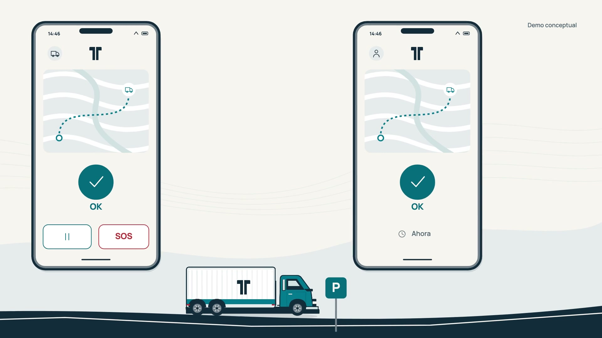

# Tándem · Demo animada de la app

Video conceptual de 45 segundos, 1920 × 1080 a 30 fps. Interacciones visuales y música instrumental original, sin narración.

El público es el dueño-conductor de uno o dos camiones de carga en Latinoamérica. La secuencia prepara el viaje, espera la aceptación de un contacto, exige la confirmación del conductor y muestra acompañamiento, pausa, reporte y SOS. No hay titulares narrativos ni párrafos: iconos y gestos muestran la secuencia. Las escenas usan datos ficticios y el sistema visual aprobado de Tándem.

Esto es una representación animada del producto, no una grabación de una ejecución real ni prueba de entrega de avisos. La aceptación, el registro del SOS, el estado de los avisos y la lectura del contacto se presentan por separado. La animación no demuestra detección de somnolencia, robos o armas, seguimiento continuo con el teléfono bloqueado ni ayuda efectiva.

## Fuentes

- Sistema visual y pantallas de `docs/design/` en `Robertzu43/andes-hackathon`, revisión `7ad66adc4f48fcb5fb4d0c8f1f88aa6b0c69b358`.
- Motor Canvas, bibliotecas de movimiento y herramientas de render y revisión de [huashu-art-motion](https://github.com/alchaincyf/huashu-art-motion). La revisión exacta está en `UPSTREAM.json`; la licencia MIT se conserva en `HUASHU-LICENSE.txt`.
- Tipografía Manrope con licencia SIL OFL, conservada en `assets/OFL.txt`.
- Música «Contigo en ruta», composición original sintetizada por `compose_music.py`. No contiene muestras, grabaciones ni voces. Procedencia en `credits.json`.



## Reproducir el render

Se necesitan `uv`, Python, FFmpeg y el navegador Chromium de Playwright. Usar un caché de navegador propio evita alterar los de otros proyectos:

```sh
PLAYWRIGHT_BROWSERS_PATH="$PWD/.browsers" PLAYWRIGHT_SKIP_BROWSER_GC=1 uv run --with playwright==1.64.0 playwright install chromium --only-shell
uv run --with numpy python compose_music.py
PLAYWRIGHT_BROWSERS_PATH="$PWD/.browsers" uv run --with playwright==1.64.0 python engine/render.py --fps 30 --crf 18 --out output/tandem-demo-visual.mp4 --audio assets/tandem-music.wav
```

Para editar las escenas, modificar `engine/scenes/tandem.js`; el orden y la duración están en `engine/eras.js`. El tamaño y los rótulos se dibujan a partir del tiempo del video, con resultados deterministas.

## Revisión

El guion visual está en `storyboard.md`. `DELIVERY.md` recoge las propiedades del MP4 y el alcance de su revisión. El video representa un recorrido propuesto con datos ficticios; las pantallas no son una grabación de uso real.
