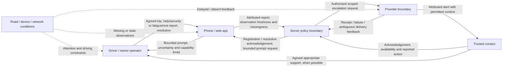

# Draft bounded control analysis

**Plan-derived preparation; not incident-validated.** This is a bounded STPA-style
working diagram and hazard-to-test table requested by [issue #11](https://github.com/Bimbi-Dev/andes-hackathon/issues/11).
It is not certification, an implemented control system, or a production event format.
The authority and missing evidence are recorded in the JSON template and README.

The boundary contains the independent freight driver/owner-operator, phone/web app,
server, provider and trusted contact. Road conditions, connectivity and device
lifecycle can remove observations or feedback. A fleet dispatcher is not assumed.
Spanish and Brazilian Portuguese are intended languages, with no tested locale yet.
No response leaves status unknown. An attributed report, suspicion, phone observation
and independently corroborated outcome remain separate evidence categories.

Arrows are conceptual control actions and feedback, not APIs. Delivery feedback
does not establish contact action. Contact acknowledgement does not establish
driver wellbeing. An old OK reply is a time-specific self-report. The server's
durable resolution and provider acceptance boundaries require later design and
evidence; no ordering, storage, queue or wire format is frozen here.

Losses: **L1** added distraction; **L2** missed/late useful help; **L3** unnecessary
alarm/attention burden; **L4** inappropriate location/route/cargo disclosure.
The cases below examine missing actions, inappropriate actions, early/late timing,
excess duration/repetition, stale actions and inadequate human feedback.

| Case / losses | Hazard and unsafe control action | Proposed test and evidence to retain | Independent acceptance / disposition boundary |
|---|---|---|---|
| C01 · L2/L3/L4 | Explicit help/security report is omitted, delayed, downgraded to routine lost contact, repeatedly escalated, or exposes cargo/route context | Reconstruct attributed help report through receipt, contact availability, acknowledgement and useful action; include failed/delayed/duplicate delivery. Retain raw source IDs, uncertainty and baseline comparison; cross-check C09 | H2 with scoped T_action, Delta_action and B_false; G4. Without timings, contact tolerance, country/channel support and independent review: inconclusive/revise; stop unsupported promises |
| C02 · L1/L2/L3 | Fatigue/rest-support request is missed, produces more distracting prompts, or a rest timer is treated as recovery | Compare reported fatigue and agreed support with ordinary rest/no-response cases; capture safe interaction limits and independent human-factors review | H1/H2 and G1/G3. Rest, parking or silence cannot establish sleep/recovery; useful support and attention limits remain unaccepted |
| C03 · L2/L3 | Uncertain lost contact causes an early, late, missing or excessive escalation; absent contact feedback is treated as action | Include no reply, phone off, denied permission, network outage, unavailable recipient and late reply; preserve uncertainty and all associated alerts | H2; action and burden limits UNSET. No reply cannot become a robbery/fatigue incident; uncertainty can lead to revise/stop/inconclusive |
| C04 · L1/L3 | Driver must look/tap/type while moving to prevent an alarm; prompting continues too often or too long | Proposed deterministic moving/no-screen-response case plus fixed-policy comparison and later human-factors observation. Retain eligible/delivered prompts and attention costs, including unsuccessful interactions | G1 zero forced screen interaction. B_attention requires an independently justified unit/window/value; scripted cases alone cannot establish safe distraction levels |
| C05 · L2/L3 | New escalation is initiated after committed resolution; retries or delayed offline closure revive stale work | Proposed deterministic resolution/dispatch orderings, restart and duplicate cases; record whether provider accepted a send before resolution and how it is reconciled | G2 zero obsolete escalation initiated after committed resolution. Earlier accepted sends are not promised recall. Any new stale send requires revise/stop |
| C06 · L2/L3 | Liveness, receipt, contact acknowledgement, missing reply or old OK report becomes an unsupported wellbeing/incident assertion | Proposed deterministic assertions for each evidence category, age and source; retain contradictions rather than combining them into a safe/unsafe label | G3 zero unsupported wellbeing assertions; H3 cannot infer sleep/robbery or reduced harm from telemetry. Independent labels remain absent |
| C07 · L3 | Outage-related alert is counted but the outage is removed from burden exposure, understating operational costs | Proposed paired trips with/without sensor/network gaps; retain all registered active trip-hours to preregistered trip-end censoring and every associated escalation. Report covered hours separately | B_false denominator must include outages; censoring rule and uncertainty are UNSET until preregistered. Lost coverage cannot improve apparent overall burden |
| C08 · L3/L4 | Location gaps or policy-driven prompting manufacture a road hotspot or a transferable regional threshold | Proposed separately qualified location-covered exposure audit; retain location qualification, missingness, policy sampling, consent and independently labelled outcomes when needed | H3; road denominator never substitutes for all-trip-hour burden. Country/language/route/device changes require stated retesting and revision; no aggregate release gate is satisfied |
| C09 · L4 | During security/help, route/cargo details reach unauthorised recipients, a stale link or a contact whose access was withdrawn | Proposed deterministic recipient/permission/withdrawal/stale-link cases; record permitted fields, purpose and disclosure decision without collecting real route/cargo data here | G4 zero unauthorised route/cargo disclosure. Security urgency cannot silently enlarge sharing. Any unauthorised disclosure requires revise/stop |

G1–G4 are zero-tolerance requirements supplied by the issue, not invented numeric
performance thresholds. They are encoded as required declarations in the template.
The local tests exercise the **checker**, including adverse case declarations. They
do not run any of C01–C09 against an app; no app exists in this lane.

H1/H2 operational information, attention and contact-action performance must stay
separate from claims of reduced robbery or fatigue-related harm. H3 is later and
conditional on driver value, consent and data gates. Nothing in this diagram proves
its causal chain. Missing source timelines, baseline variation, contact tolerance,
device/provider limits or independent review require evidence acquisition under
separate authorisation, narrowing the promise, or stopping it.
